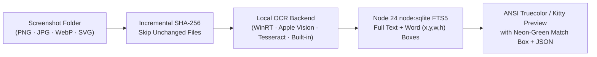

# pixgrep

**Offline `ripgrep` for screenshots and images with SQLite FTS5 incremental SHA-256 indexing, OS-native OCR backends, and inline terminal previews with neon-green match bounding boxes (zero runtime dependencies).**

[](./LICENSE)
[](https://nodejs.org)
[](#architecture)

---

## Try It in 2 Seconds (Zero Setup)

```bash
npx pixgrep --demo
```

Generates 4 realistic local screenshots (TLS `ERR_CERT_AUTHORITY_INVALID`, AWS invoice, Postgres pool error, flight receipt), indexes them into SQLite FTS5, matches `ERR_CERT`, and renders a truecolor terminal preview with a neon-green bounding box around the matched text.

---

## Quick Start

```bash
# Search your Screenshots folder with inline terminal preview + match bounding box
npx pixgrep "ERR_CERT" ~/Screenshots --preview

# Use Kitty graphics protocol in Ghostty / Kitty / WezTerm
npx pixgrep "invoice" ~/Downloads --preview --protocol kitty

# Machine-readable JSON output for scripts & agents
npx pixgrep "pg_pool" ~/Screenshots --json

# Pre-index a large folder incrementally (SHA-256 skips unchanged files)
npx pixgrep index ~/Screenshots
```

---

## 100% Local OS-Native OCR Backends

`pixgrep` never uploads screenshots to any cloud API. In `--backend auto` mode it picks the fastest local OCR engine available on your machine:

| Platform | Default Local Engine | Extra Installs Required? | Word Bounding Boxes |
|---|---|---|---|
| **Windows 10/11** | Native `Windows.Media.Ocr` (WinRT) | **None** (built into Windows) | **Yes** |
| **macOS** | Native Apple Vision (`VNRecognizeTextRequest`) | **None** (built into macOS) | **Yes** |
| **Linux / Cross-OS** | `tesseract` CLI (`tsv` output) | `tesseract-ocr` | **Yes** |
| **SVG / PNG `tEXt` / `.ocr.json`** | Built-in zero-dep parser | **None** | **Yes** |

---

## Honest Comparison

| Feature | `pixgrep` | `ripgrep-all` (`rga`) | Paperless-ngx |
|---|---|---|---|
| **Incremental SQLite FTS5 SHA-256 index** | **Yes** (instant repeat search) | No (re-runs OCR) | Yes (heavy stack) |
| **Inline terminal preview + match bounding box** | **Yes** (Half-block + Kitty) | No (text only) | Web UI only |
| **Zero-container CLI install** | **Yes** (`npx pixgrep`, 0 runtime deps) | Requires Poppler + Tesseract | Multi-container Docker stack |
| **Where alternatives win** | (Instant local screenshot grep) | Broad archive/PDF/Office adapters | Full multi-user document management web app |

---

## Architecture



## License

[MIT](./LICENSE)
